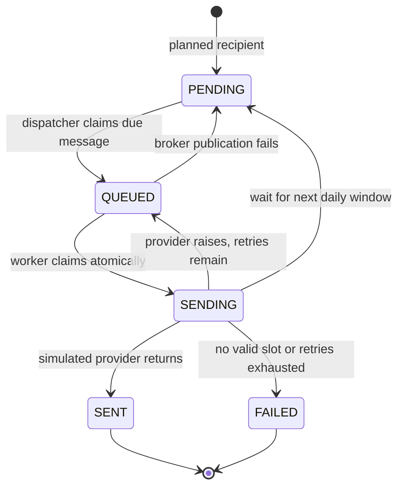

# Delivery lifecycle

[Project overview](../README.md) · [Regression tests](../api/tests/test_delivery_lifecycle.py)

This project demonstrates a database-backed delivery journal and a simulated provider. The useful property to inspect is how duplicate task invocations interact with delivery state.

## Concurrent delivery

The worker uses one conditional SQL update: `WHERE id = ? AND status = 'QUEUED'` to set `SENDING`. Only the caller that changes a row may call the provider. A second delivery of that task returns while the first is in flight. The database transaction ends before the provider call.

After successful sending, later duplicate tasks see a terminal state and return. `PENDING` messages cannot bypass the dispatcher. A queued task whose daily window has closed returns to `PENDING` with its next allowed time; an expired campaign becomes `FAILED` without calling the provider.

Transient provider exceptions return the message to `QUEUED` for up to three Celery retries, after the initial attempt. The run remains `RUNNING` until delivery succeeds or the retry budget is exhausted. Status aggregation locks campaign then run, matching the start endpoint's lock order. `SENDING` counts as unfinished work.

Repeated start tasks cannot add recipients to an initialized run. A superseded run cannot become active again. Explicit resends create a separate journal run after the previous run has ended.

## What a real provider would still need

The claim prevents simultaneous normal workers from sending the same message. It cannot atomically commit a remote side effect and a local database update.

| Failure | Current behavior | Production extension |
| :--- | :--- | :--- |
| Broker rejects message publication | Dispatcher restores `PENDING` | Monitor dispatcher errors and broker health |
| Process exits between marking `QUEUED` and publication | Message may remain `QUEUED` | Transactional outbox and acknowledgement/reconciliation |
| Worker exits after claiming `SENDING` | Message remains `SENDING`; duplicate tasks skip it | Provider idempotency key plus reconciliation before replay |
| Provider accepted a request but its response was lost | A retry could repeat the external action | Stable provider idempotency key, keyed by message ID |
| Initial campaign-start publication fails | Run persists but may require recovery | Durable run-start outbox |

Do not automatically reset an uncertain `SENDING` row. Reconcile the provider result first; a blind timeout-based replay could send twice. The current adapter only simulates delivery, so no external message or charge occurs.

The API is a single operator workspace: authenticated accounts share clients and campaigns. It does not implement tenant isolation or recipient consent management.

## Verification

`test_delivery_lifecycle.py` covers overlapping invocations, terminal replay, future and expired deliveries, retry state, retry recovery, active-run resend rejection and stale starts. PostgreSQL CI additionally overlaps two workers using separate connections; the SQLite run explicitly skips that concurrency test. `scripts/demo.py` exercises JWT authentication, API validation, scheduling, simulated sending and statistics using a fresh temporary database.

The PostgreSQL test invokes the task function from two threads. It verifies database claim behavior; it does not replace a broker-backed deployment test.

Design references: [Celery task retries](https://docs.celeryq.dev/en/stable/userguide/tasks.html#retrying), [Django row locking](https://docs.djangoproject.com/en/5.2/ref/models/querysets/#select-for-update).
